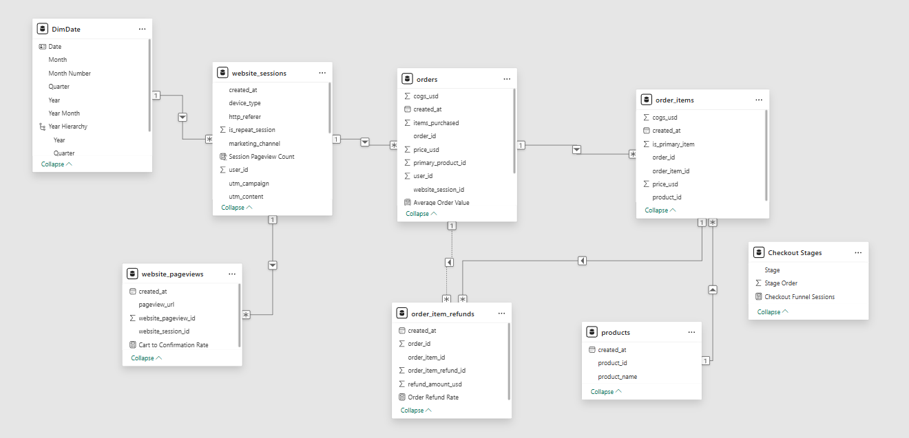

# Fuzzy Factory Store \| E-Commerce Analytics

A Power BI portfolio project analysing website traffic, marketing
performance, checkout behaviour, orders, revenue and refunds for a
fictional toy retailer.

**Tools:** Power BI Desktop, Power Query, DAX\
**Dataset:** Maven Analytics Toy Store E-Commerce Database

## Project overview

This project turns website and transaction data into a three-page
analytical report to help stakeholders understand how visitors arrive,
how they move through checkout, and how the business performs
commercially.

## Business questions

-   How do sessions, orders and revenue change over time?
-   What proportion of sessions result in an order?
-   Which marketing channels and devices generate traffic and revenue?
-   How do average order value and revenue per session change?
-   How many sessions reach each checkout stage?
-   What is the value of refunds and what share of orders have a refund?

## Report pages

### 1. Executive Overview

High-level KPIs: Total Sessions, Total Orders, Conversion Rate, Total
Revenue, Average Order Value and Revenue per Session. Supporting visuals
compare revenue by marketing channel and sessions/orders over time.

### 2. Marketing Performance

Compares sessions, orders, conversion and revenue across marketing
channels and devices. The source data described for this project does
not include marketing spend, so ROAS and marketing ROI are not
calculated.

### 3. Conversion & Funnel Analysis

Examines page activity, bounce behaviour, average pageviews per session,
checkout-stage reach and refunds.

Checkout stages: **Cart → Shipping → Billing → Order Confirmation**

Billing combines `/billing` and `/billing-2`. Order confirmation uses
`/thank-you-for-your-order`.

The funnel counts distinct sessions reaching each URL. It does not prove
that each session followed the stages in sequence. The source timestamps
were converted to dates, so within-session event ordering cannot
reliably be reconstructed.

## Data model

  Table                  Purpose
  ---------------------- ------------------------------------------
  `website_sessions`     Session, marketing and device attributes
  `website_pageviews`    Pageview events and page URLs
  `orders`               Order-level transactions and revenue
  `order_items`          Products included in orders
  `order_item_refunds`   Refunded order items and refund amounts
  `products`             Product attributes
  `DimDate`              Calendar attributes

Expected relationship paths: - `website_sessions[website_session_id]` →
`website_pageviews[website_session_id]` -
`website_sessions[website_session_id]` → `orders[website_session_id]` -
`orders[order_id]` → `order_items[order_id]` - `products[product_id]` →
`order_items[product_id]` - `order_items[order_item_id]` →
`order_item_refunds[order_item_id]`

Verify actual column names, cardinality, active status and filter
direction in Model view. Avoid ambiguous date paths.

## Key metric definitions

-   **Conversion Rate:** Orders divided by sessions. If a session can
    place multiple orders, this is orders per session, not the
    percentage of sessions that converted.
-   **Session Conversion Rate:** Distinct sessions with an order divided
    by total sessions.
-   **AOV:** Revenue divided by orders.
-   **Revenue per Session:** Revenue divided by sessions.
-   **Bounce Rate:** Sessions with exactly one recorded pageview divided
    by sessions.
-   **Order Refund Rate:** Distinct orders with at least one refunded
    item divided by total orders. This is not an RTO rate.

See `Documentation/DAX_Measures.md` for starter DAX calculations

## How to use

1.  Download `PowerBI/Fuzzy_Factory_Analytics.pbix`.
2.  Open it in Power BI Desktop.
3.  If source CSVs are stored externally, update source paths and
    refresh.
4.  Use the date, marketing-channel and device slicers.
5.  Navigate through the three report pages and interact with visuals.
